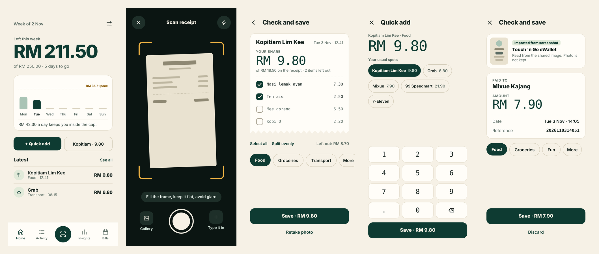
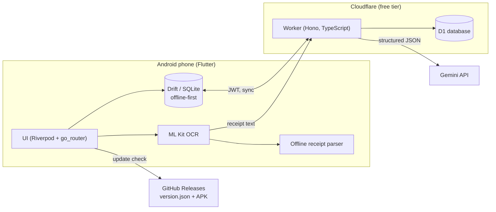

<div align="center">

# Cukup

**A free, private spending companion for Malaysia.**
Scan a receipt, split the bill with friends, and stay under a weekly cap, all without a subscription.


[Download](#download) · [Features](#features) · [Architecture](#architecture) · [Engineering highlights](#engineering-highlights) · [Getting started](#getting-started) · [Docs](#documentation)

</div>

<p align="center"></p>
<p align="center"><sub>Screens from the Cukup design prototype (sample data): this week, scan, check and save, quick add, screenshot import.</sub></p>

---

## Download

Android only (sideloaded). Grab the latest APK from the [Releases page](https://github.com/Liew2005/cukup-releases/releases/latest), allow installs from your browser when Android asks, and open it. The app updates itself from this same release feed.

The public build talks to the author's own private backend, so to use it for yourself, deploy your own Worker and build the app (see [Getting started](#getting-started)).

## Why Cukup?

*Cukup* means "enough" in Malay. Most expense trackers want a subscription, a bank login, or both. Cukup is built around one question: **"Am I still within what I decided is enough this week?"**

It is a personal project I designed, built, and use every day. It covers the full path from idea to product: requirements and planning, a Flutter Android client, a serverless backend, an OCR and AI receipt pipeline, over-the-air updates, and a test suite. It runs on free tiers, so the running cost is RM 0.

## Features

| | |
|---|---|
| **Receipt scanning** | Photograph a receipt. Text is read on the phone (Google ML Kit), then structured by Gemini through the backend. If the server is unreachable, an offline rule-based parser reads English, Malay and Chinese receipts. Only printed tax and service charge are used; nothing is guessed. |
| **Quantity-aware review** | Each line keeps quantity and unit price (3 x RM 5.00, not three duplicate rows). Everything is editable, and a warning appears when items plus charges do not match the receipt total. |
| **Weekly cap** | Set a weekly limit. Overspending carries into the next weeks at a capped rate, and the carry is recomputed from the data, so editing an old entry corrects every later week. |
| **Split bills with friends** | Tap names per item, split evenly, or treat someone. Tax, service charge and rounding are shared in proportion to what each person had, accurate to the sen. Only your share counts toward your spending. |
| **Friends ledger** | Per-friend balances, payments, and debts that stay bound to their receipt: edit the receipt and the debts update, delete it and they go away (with Undo). |
| **Collect payment** | One-tap reminder message with your pay link and QR, sent through WhatsApp, with contacts picked from the phone. |
| **Payment detection** | Reads payment notifications from e-wallet and bank apps (TNG eWallet, ShopeePay, Grab and six Malaysian banks) on the device and asks "Save?" from the notification itself, so logging a payment takes one tap without opening the app. |
| **Screenshot import** | Share a Touch 'n Go or bank payment screenshot to Cukup. Amount, payee, reference and date are read on the phone. |
| **Quick add** | Tap a usual shop, key in an amount, save. Categories are learned from past choices. Spending in the Bills category stays out of the weekly cap by default, with a per-entry switch. |
| **Bills and recurring** | SPayLater and other bills, plus rent, salary and subscriptions that post themselves each month, including months missed while the app was closed. |
| **Savings sweep** | Money left under last week's cap can be moved toward a savings goal in one tap. |
| **Insights** | Period totals, a category donut, an 8-week trend, and a weekly pace chart. |
| **Native touches** | Home-screen widget, Quick Settings tile and launcher shortcut for Quick add, local notifications (bills, daily, weekly, cap alerts), biometric app lock, CSV export. |
| **OTA updates** | The app checks a public release feed and installs new APKs itself. |

More detail: [docs/FEATURES.md](docs/FEATURES.md).

## Architecture



The phone is the source of truth for the person using it and works fully offline. The Worker stores a copy, parses receipts, and keeps a second device in step. Details in [docs/ARCHITECTURE.md](docs/ARCHITECTURE.md).

### Tech stack

| Layer | Choices |
|---|---|
| Client | Flutter, Dart, Riverpod 3, go_router, Drift (SQLite), Dio, ML Kit text recognition, local_auth, flutter_local_notifications, home_widget |
| Backend | Cloudflare Workers, Hono, D1 (SQLite), TypeScript |
| AI | Gemini structured output (JSON schema) with a deterministic reconciliation step |
| Security | PBKDF2 password hashing, JWT sessions, optional TOTP two-factor, login rate limiting, secrets kept out of source |
| Delivery | Signed release APKs, GitHub Releases as an update feed, PowerShell release script |

## Engineering highlights

- **Money is never a float.** Every amount is an integer number of sen. Splits use largest-remainder allocation so shares always add up to the receipt exactly.
- **Don't trust the model.** Gemini output is passed through a reconciliation step (`worker/src/receipt.ts`) that enforces quantity x unit price, copies only printed tax lines, and flags totals that do not match, instead of silently "fixing" them.
- **Offline first, sync that cannot double-post.** Entries have client-made UUIDs and soft deletes, so syncing twice never duplicates. Recurring entries use fixed ids per item and month.
- **Derived, not stored.** The weekly carry-over is computed from entries every time, so it can never drift out of date.
- **Pure, tested core.** Split maths, carry-over, duplicate detection, recurring schedules, the notification and screenshot parsers and the update parser are plain Dart with unit tests and no Flutter dependency.
- **Private by design.** Payment detection uses an allowlist of apps, masks long numbers before logging, never logs personal messages, and keeps everything on the device.
- **Security by default.** All routes except `/health` and `/auth` require a token. CSV export neutralises spreadsheet formula injection. See [docs/SECURITY.md](docs/SECURITY.md).
- **Zero-cost operations.** The whole system runs on free tiers. Placement is pinned to Singapore to avoid Gemini region blocks.

## Project structure

```
cukup/
├── app/                     Flutter Android app
│   ├── lib/
│   │   ├── core/            Pure logic: splits, ledger, carry, parsing, CSV
│   │   ├── data/            Database, API client, sync, OCR, notifications
│   │   ├── features/        Screens and widgets
│   │   └── theme/
│   ├── test/                Unit tests
│   └── android/             Widget, shortcuts, notification listener, Quick Settings tile, installer provider
├── worker/                  Cloudflare Worker API
│   ├── src/                 Routes, auth, TOTP, receipt reconciliation
│   ├── migrations/          D1 schema and seed
│   └── scripts/             Password, 2FA and secret-rotation helpers, tests
├── scripts/release.ps1      Build, sign and publish an OTA release
├── scripts/export-public.ps1  Builds this public copy with placeholders
└── docs/                    Architecture, features, API, setup, security
```

## Getting started

You need Flutter, Node 20+, a free Cloudflare account and a free Gemini API key.

```bash
# 1. Backend
cd worker
npm install
npx wrangler d1 create cukup            # copy the database_id into wrangler.toml
npx wrangler d1 migrations apply cukup --remote
node scripts/hash-password.mjs "a long password"   # prints the hash
npx wrangler secret put APP_PASSWORD_HASH
npx wrangler secret put JWT_SECRET
npx wrangler secret put GEMINI_API_KEY
npx wrangler deploy

# 2. App
cd ../app
# set apiBase in lib/core/config.dart to your Worker URL
flutter pub get
flutter run
```

The full walkthrough, including signing, 2FA and OTA releases, is in [docs/SETUP.md](docs/SETUP.md).

### Tests

```bash
cd app && flutter analyze && flutter test
cd worker && npm run typecheck && node scripts/receipt.test.mjs
```

## Documentation

| Document | What is in it |
|---|---|
| [Features](docs/FEATURES.md) | Every feature and how it behaves |
| [Architecture](docs/ARCHITECTURE.md) | Components, data model, sync, receipt pipeline, split maths |
| [API reference](docs/API.md) | Worker endpoints |
| [Setup](docs/SETUP.md) | Deploy the backend, build the app, ship updates |
| [Security](docs/SECURITY.md) | Threat model and protections |

## Notes on this repository

This is a public, sanitised copy of a personal project. The deployed backend URL, database id, personal payment QR and pay link, signing keys and my own seed data are intentionally not included; placeholders mark where to add yours. Prebuilt APKs are on the [Releases page](https://github.com/Liew2005/cukup-releases/releases).

## Author

**Liew Yu Yuan**, Computer Science (Data Analytics) student at Asia Pacific University and freelance web developer based in Kuala Lumpur.
[GitHub](https://github.com/Liew2005)

## License

[MIT](LICENSE)
