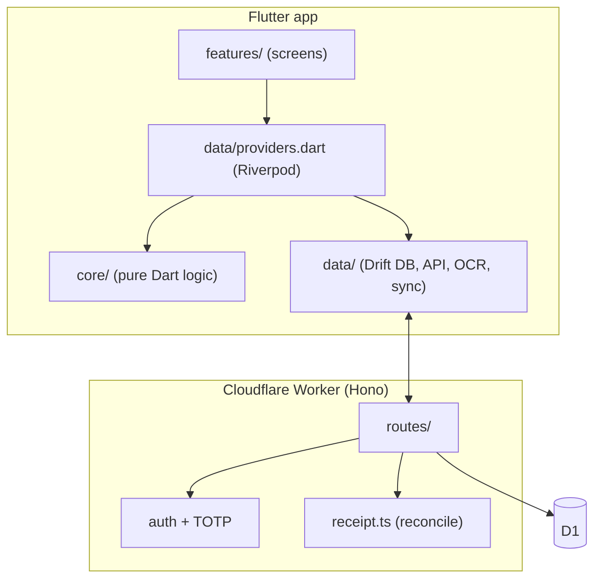
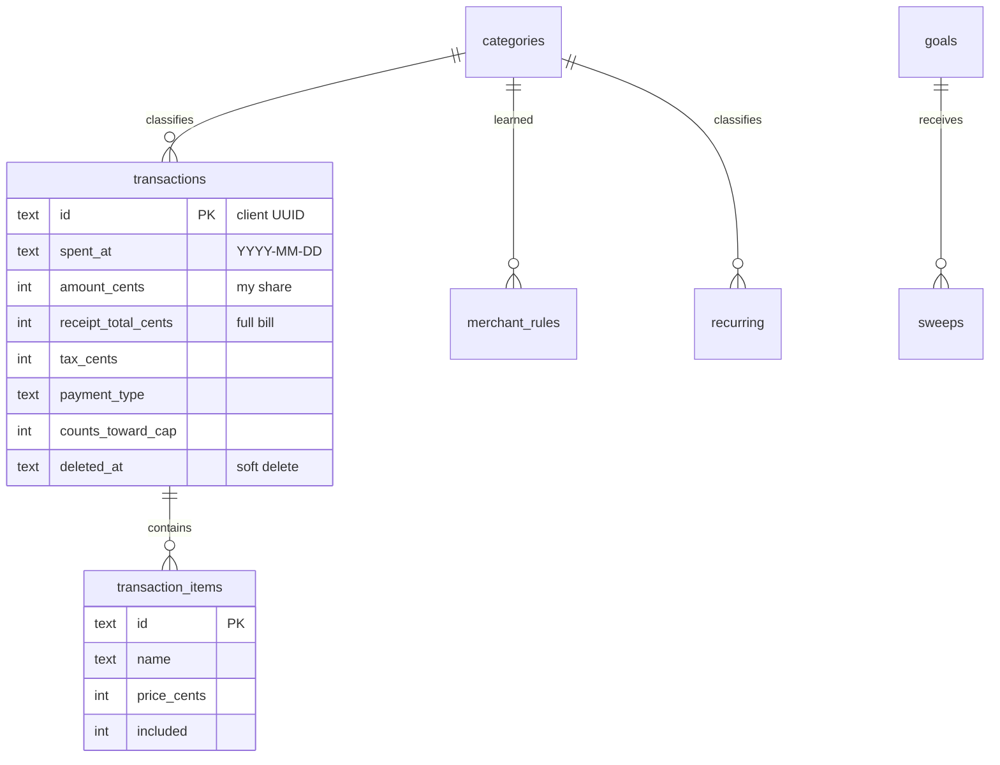
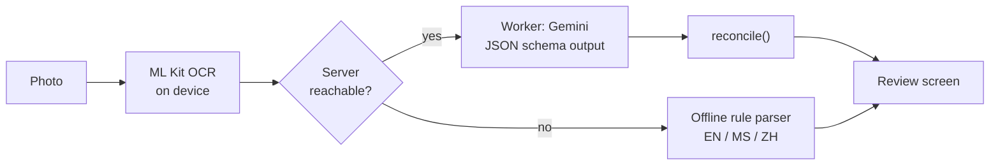
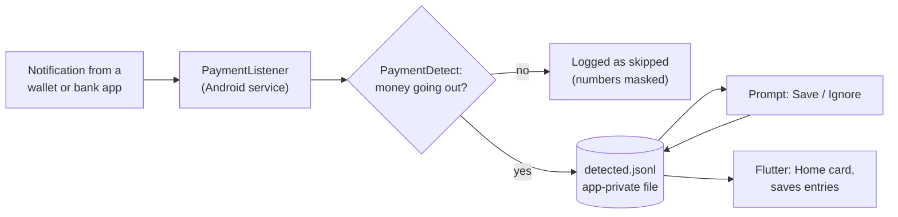

# Architecture

Cukup is a two-part system: an offline-first Flutter app and a small serverless API. Everything runs on free tiers.

## Components

| Layer | Responsibility |
|---|---|
| `core/` | Pure Dart: money formatting, bill splitting, friends ledger, weekly carry-over, duplicate detection, recurring schedule, screenshot parser, CSV, update parsing. No Flutter imports, so it is fast to unit test. |
| `data/` | Drift database, API client, sync, ML Kit OCR, offline receipt parser, notifications, widget sync, OTA updater. |
| `features/` | One file per screen or reusable widget. |
| Worker | Auth, CRUD and sync endpoints, receipt parsing, CSV export, ledger storage. |

## Data model

Design choices:

- **Integer cents everywhere.** `RM 12.50` is `1250`. No floating point touches money.
- **Client-generated UUIDs** mean a retried sync can never create duplicates.
- **Soft deletes** (`deleted_at`) let deletions propagate to other devices.
- **ISO 8601 UTC timestamps** compare correctly as strings, which keeps "newer wins" logic simple.
- **Dates are plain `YYYY-MM-DD` in Malaysia time (UTC+8)**, so a late-night entry lands on the day the user means.

## Sync

The phone writes first and syncs when it can: push local changes, then pull anything newer (`updated_since`). Entries merge by `updated_at`. The friends ledger is a single JSON document stored in its own table; the phone is the only writer, so the newest copy wins. A local dirty flag decides whether to push, and an older server that lacks the endpoint is tolerated.

## Receipt pipeline

1. The image is turned into text on the phone, so the photo itself never has to leave the device.
2. The text goes to the Worker, which asks Gemini for structured output against a JSON schema (items with quantity and unit price, service charge, SST, total).
3. `reconcile()` in `worker/src/receipt.ts` enforces the arithmetic: quantity x unit price must match the line total, and tax and service are copied only when printed.
4. If the server is unreachable or fails, the on-device parser takes over with a deliberately cautious confidence score, so uncertain fields are highlighted for the user to check.

Malaysia has two common charges, a 6% SST and a 10% service charge, and shops differ in which they apply. The pipeline reads what is printed and never calculates tax itself. The review screen warns if items plus charges do not match the receipt total.

## Payment detection

The listener is a native `NotificationListenerService`, so it works while the Flutter app is closed. It only looks at an allowlist of apps, matched by package name or app label. A small pure function decides whether the text is money going out (an RM amount plus payment wording, and none of the words that mean incoming money, codes, adverts or failures).

The service and the app communicate through one append-only file in the app's private storage: the service appends detections and the Save / Ignore taps, and Flutter only reads it. Flutter keeps its own list of handled ids, so there is a single writer per store and no locking. When the app next opens or resumes it turns every "Save" into an entry with a fixed id (`det-<id>`), which makes saving idempotent.

The decision rules exist twice, in Kotlin (used while the app is closed) and in Dart (`core/pay_notif.dart`, unit tested, also extracts the shop name). They are kept textually identical.

## Split maths

A bill becomes a list of slots, one per unit ordered. Each slot records who had it; several people on one slot share it evenly, and a slot can be marked as a treat.

1. Each person's subtotal is the sum of their slots.
2. Tax, service charge and rounding are spread in proportion to those subtotals using **largest-remainder allocation**, so the shares add up to the receipt total to the sen.
3. Slots nobody is tracking take their share of tax but are charged to nobody.
4. A treat puts the slot on the payer, so it counts toward their weekly spending.
5. Odd sen go to the payer.

Only the payer's own share is saved as the transaction amount and counts toward the weekly cap. Each friend's share becomes a debt linked to the transaction id, so editing the receipt replaces its debts and deleting it removes them.

## Weekly cap and carry-over

Overspending in a week becomes debt that later weeks repay, taking at most a fixed share of the base cap each week. Underspending is never added to a later week; leftover money goes to the optional savings sweep instead. The available cap is derived from entries on demand, so edits to past entries correct everything after them.

## Notifications and widget

Reminders (bills, daily nudge, weekly summary, cap alerts) are scheduled locally, so they work offline and cost nothing. The home-screen widget is updated whenever the cap or this week's spend changes.

## Over-the-air updates

`scripts/release.ps1` bumps the build number, builds a signed arm64 release APK, and publishes it with a small `version.json` to a public GitHub releases repo. The app reads that file once per launch, compares build numbers, and hands the downloaded APK to the Android installer through a `FileProvider`.
